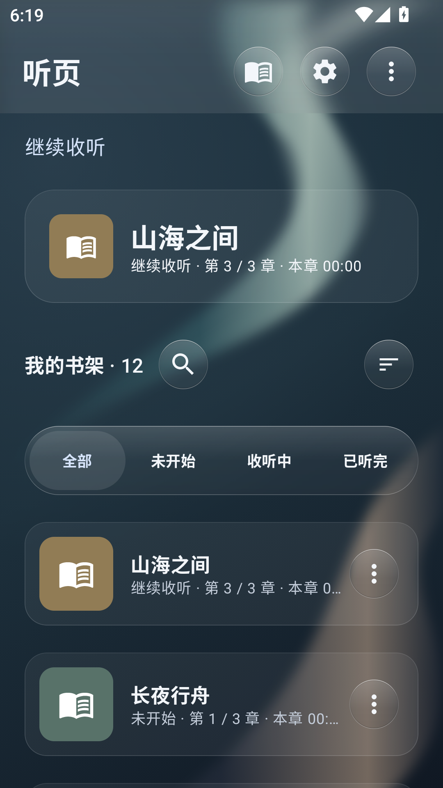
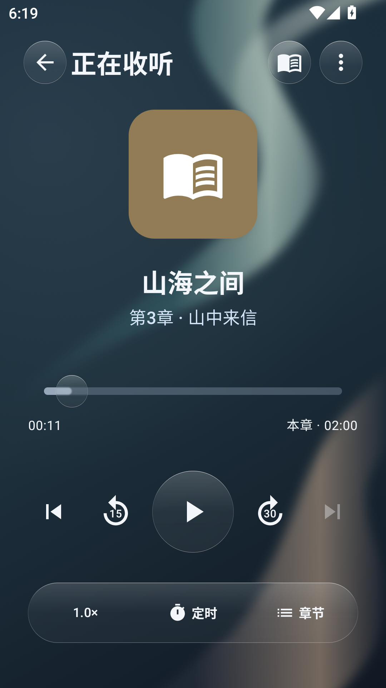
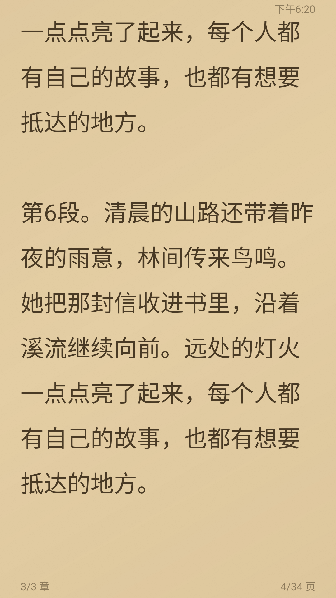
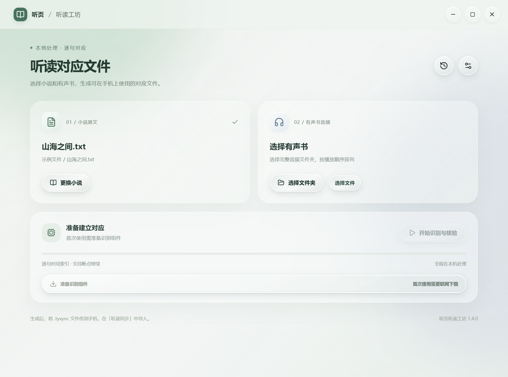

# 听页 TingYe

本地听书与小说阅读应用，包含 Android 客户端和 Windows 听读对应工具。

| 程序 | 版本 | 安装包 |
| --- | --- | --- |
| Android | 0.5.0 · Android 8.0+ · ARM64 | [下载 APK](https://github.com/1772866953/TingYe/releases/download/v0.5.0/TingYe-0.5.0-release.apk) |
| Windows | 1.4.0 · x64 | [下载 EXE](https://github.com/1772866953/TingYe/releases/download/v0.5.0/TingYe-Aligner-1.4.0-Setup.exe) |

## 功能

### Android

- 文件、文件夹和批量有声书导入，提取书名与封面；书架搜索、排序、筛选。
- 章节独立进度、已听标记、倍速、快进快退、片头片尾跳过、音量均衡、进度误操作恢复。
- 睡眠定时、音量渐弱、通知与锁屏控制、耳机按键设置、桌面小组件、收听统计和本地备份。
- TXT、EPUB 2/3、HTML、Markdown 阅读；平移、仿真翻页和上下滚动；字体、字号、行距与纸张背景设置。
- 小说与有声书关联，支持大致同步、手动校准、字幕对应，以及导入 PC 生成的 `.tysync` 逐句时间索引。
- 实时玻璃模糊与折射、方向拖拽形变、弹簧动画、重力边缘光照；壁纸、通透度、阴影、折射与触觉反馈设置。

### Windows

- 本地语音识别、字符时间对齐和小说短句匹配，按标点切分定位单元。
- 识别后执行文本核验与音频回查，保留无法对应的广告、旁白等片段。
- NVIDIA GPU 加速，显存预算 1–32 GB；识别组件和模型目录可配置、可删除。
- 暂停续跑、历史记录、单条与批量删除、从识别缓存重新导出 `.tysync`。

## 界面

以下为 Android 模拟器和 PC 隔离测试环境截图。书名、正文及书架均为合成测试数据，不含真机数据。

<p>
  
  
  
</p>



## 代码结构

```text
TingYe/
  app/src/main/java/com/tingye/app/
    data/          书架、数据库、偏好设置、备份与统计
    playback/      播放服务、章节进度、媒体控制与音频处理
    reader/        小说解析、分页渲染、翻页与听读同步
    widget/        桌面小组件
    Glass*.kt      玻璃组件、拖拽物理与重力光照
  app/src/test/    单元测试
  app/src/androidTest/  设备端同步验证
  app/schemas/     Room 数据库迁移结构
  scripts/         构建与性能采集脚本
TingYeDesktop/
  src/             React 界面与玻璃组件
  electron/        窗口、IPC、环境管理、任务与历史记录
  engine/          Python 识别、文本匹配、二次核验与格式导出
  scripts/         Python 环境准备
  build/           图标与安装器配置
  licenses/        第三方许可
assets/screenshots/  合成数据截图
signing/release.properties.example  签名配置模板
```

## 技术与构建

### Android

Kotlin、Jetpack Compose、Material 3、Media3、Room、DataStore、Coroutines。玻璃效果使用 Android 图形层、RenderEffect 与着色器；翻页使用原生 Canvas 和 GPU 渲染路径，按系统版本提供兼容实现。

构建环境：JDK 17、Android SDK 36、Gradle 8.13。使用 Android Studio 打开 `TingYe/`，配置 SDK 后运行：

```sh
cd TingYe
./gradlew testDebugUnitTest assembleDebug
```

Windows 使用 `gradlew.bat`。正式构建前，将 `signing/release.properties.example` 复制为 `signing/release.properties` 并填写本地签名配置，再执行 `assembleRelease`。也可通过 `TINGYE_SIGNING_PROPERTIES` 指定配置路径。

### Windows

Electron、React、TypeScript、Vite、Motion。Python 引擎使用 PyTorch、Torchaudio、FunASR / SenseVoice Small、CTC 时间对齐、RapidFuzz 与 FFmpeg。模型与 GPU 运行环境由程序单独下载，不包含在安装包中。

安装 Node.js 后执行：

```sh
cd TingYeDesktop
npm ci
npm run build
npm start
```

打包前准备 FFmpeg，将 `ffmpeg.exe` 放入 `TingYeDesktop/resources/bin/`，再运行 `npm run installer`。现有安装包使用 FFmpeg 7.1 GPL 构建，来源和许可见 `TingYeDesktop/licenses/NOTICE`。

PC 存储与历史记录测试运行 `npm run test:desktop`；Python 引擎测试运行 `npm test`，需安装 `engine/requirements.txt` 及对应的 PyTorch 环境。Android 单元测试位于 `app/src/test/`，可选大型 EPUB 样本通过 `TINGYE_TEST_EPUB` 指定。
